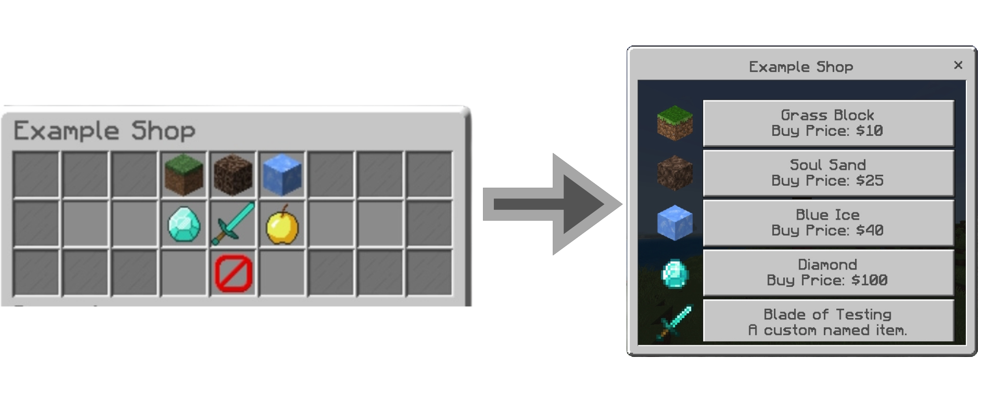

# CrossUI

<p align="center">
  
</p>


  
  
  
  <a href="https://github.com/natan307/CrossUI/wiki"></a>
  <a href="https://patreon.com/Natan307"></a>
</p>

<p align="center">
  <a href="https://patreon.com/Natan307"></a>
</p>

**One UI call. Every client.**
CrossUI is a UI translation middleware and cross-platform API for Minecraft servers. It unifies the three UI systems that exist on modern servers (Bedrock Forms, Java native Dialogs and classic chest GUIs) so that admins get a better experience for Bedrock players with zero configuration, and plugin developers write their UI code once.

- Wiki: <https://github.com/natan307/CrossUI/wiki>
- Source: <https://github.com/natan307/CrossUI>
- License: [MIT](LICENSE)
- Support the project: <https://patreon.com/Natan307>

---

## Table of contents

1. [Features](#features)
2. [How it works](#how-it-works)
3. [Supported platforms](#supported-platforms)
4. [Requirements](#requirements)
5. [Installation](#installation)
6. [Commands and permissions](#commands-and-permissions)
7. [Configuration](#configuration)
8. [Developer API](#developer-api)
9. [Platform behavior](#platform-behavior)
10. [Known limitations](#known-limitations)
11. [Metrics (bStats)](#metrics-bstats)
12. [Building from source](#building-from-source)
13. [Project structure](#project-structure)
14. [Troubleshooting](#troubleshooting)
15. [Roadmap](#roadmap)
16. [Contributing](#contributing)
17. [Support](#support)
18. [License](#license)

---

## Features

CrossUI works in two modes at the same time.

### Passive mode (for server admins, zero config)

Drop `CrossUI.jar` into `plugins/` and it works with zero configuration. No other plugin is needed: PacketEvents is bundled inside the jar. CrossUI sits on the network layer between your server and the client.

- **Chest GUI to Bedrock Form.** Inventory menus opened by other plugins (shops, warps, auction houses, crates, ...) are held back for Bedrock players and shown as native Bedrock Forms instead. Pressing a button sends a real click back to the plugin that owns the menu.
- **Smart filtering.** Empty slots and decorative frame items (glass panes, iron bars, items with a blank name) are removed so only real buttons remain.
- **Dual-click detection.** If an item advertises both a left-click and a right-click action in its lore, the player is asked which one to run.
- **Menu blacklist.** Skip fast animated menus such as crate roulettes by title (plain text or regex).
- **Safe fallback.** If a menu has no usable buttons, it is shown normally instead of being hidden.

### API mode (for plugin developers)

Other plugins can depend on CrossUI and describe a menu, a text input or a confirmation once. CrossUI detects the player's client and shows the most modern UI that client supports.

```java
CrossUI.input(player)
    .title("Transfer Balance")
    .label("Enter the amount to send:")
    .placeholder("Example: 5000")
    .onSubmit((p, text) -> bank.transfer(p, text))
    .open();
```

The same code produces a Java native Dialog, a Bedrock CustomForm, a chat prompt or a chest GUI, depending on who is looking at it.

---
---

## Example

A classic chest GUI from another plugin (left) is turned into a native Bedrock Form (right) automatically. Decorative slots are removed, every named item becomes a button, and the first lore line is shown as the button subtext.

<p align="center">
  
</p>

---

## How it works

```
                    +-------------------+
 Other plugin ----> |  Chest inventory  |----+
 (shop, warp, ...)  +-------------------+    |  OPEN_WINDOW / WINDOW_ITEMS
                                              v
                                    +--------------------+     Bedrock player
                                    |  CrossUI           | --> Bedrock Form
 Plugin using the API  ------------>|  (PacketEvents)    | --> Java Dialog (1.21.6+)
 CrossUI.menu / input / confirm     |                    | --> Chest / chat (old Java)
                                    +--------------------+
                                              ^
                       fake CLICK_WINDOW / CLOSE_WINDOW packets
```

1. **Platform detection.** When a player is first needed, CrossUI checks Floodgate (preferred) or Geyser to find Bedrock players. For Java players it reads the client protocol version: 1.21.6 or newer gets native dialogs, older clients (for example through ViaVersion) get the legacy renderer.
2. **Interception (Bedrock only).** For chest-type containers (9x1 to 9x6), the `OPEN_WINDOW` packet is cancelled before it reaches Geyser, then `WINDOW_ITEMS` is read and filtered into buttons.
3. **Injection.** When the player taps a button or closes the form, CrossUI injects a `CLICK_WINDOW` or `CLOSE_WINDOW` packet into the server pipeline so the owning plugin reacts exactly as if a real inventory had been used and can free its resources.
4. **Refresh.** After a click, CrossUI waits a short time for the menu to update and then shows the refreshed form, or ends the session if the menu closed.

Everything runs on network threads and per-player scheduling, never on world or entity state, which is why it is safe on Folia.

---

## Supported platforms

| Server | Supported |
| --- | --- |
| Spigot | Yes |
| Paper | Yes |
| Purpur | Yes |
| Folia | Yes (`folia-supported: true`) |

- **Minecraft versions:** 1.21.x up to 26.3 (the newest version supported by the bundled PacketEvents).
- **One jar for all.** CrossUI is compiled against `spigot-api`, so the same file runs on Spigot and Paper without `NoClassDefFoundError`. Text is read through the Adventure API bundled with PacketEvents, so item names and lore (including RGB colors) work on Spigot too.
- **Java:** 21 or newer.

---

## Requirements

**No dependency on the PacketEvents plugin.** PacketEvents is bundled and relocated inside `CrossUI.jar`, so it never conflicts with other plugins, even if the PacketEvents plugin is also installed. Support for new Minecraft versions arrives with CrossUI releases.

| Dependency | Type | Purpose |
| --- | --- | --- |
| [Floodgate](https://geysermc.org/download#floodgate) | Optional (recommended) | Bedrock detection and forms |
| [Geyser-Spigot](https://geysermc.org/download) | Optional | Fallback for Geyser-only servers |
| [ViaVersion](https://viaversion.com/) | Optional | Older Java clients |

Without Floodgate or Geyser, CrossUI still works for Java players (native dialogs and legacy GUIs).

---

## Installation

1. Download `CrossUI.jar` and place it in the `plugins/` folder.
2. (Bedrock support) Install **Floodgate**, or **Geyser-Spigot** alone.
3. Start the server. The log shows the detected Bedrock bridge and whether native dialogs are available:

   ```
   [CrossUI] Enabled on Paper | Bedrock bridge: Floodgate | Native dialogs: available
   ```

4. Join and run `/crossui testgui` to see the best UI for your client.

Native Java dialogs need a server on **1.21.6 or newer**. On older servers CrossUI uses the legacy renderer for Java players.

---

## Commands and permissions

| Command | Permission | Description |
| --- | --- | --- |
| `/crossui` | `crossui.admin` | Shows usage and the wiki link |
| `/crossui reload` | `crossui.admin` | Reloads `config.yml` |
| `/crossui testgui` | `crossui.admin` | Opens a test menu with input and confirmation examples |

Alias: `/cui`. The `crossui.admin` permission defaults to operators.
`/version CrossUI` shows the plugin description and the wiki link.

---

## Configuration

File: `plugins/CrossUI/config.yml`. Run `/crossui reload` after editing.

| Key | Default | Description |
| --- | --- | --- |
| `debug` | `false` | Print extra information about intercepted menus |
| `bedrock.convert-chest-guis` | `true` | Convert chest GUIs of other plugins into Bedrock forms |
| `bedrock.title-blacklist` | `Roulette`, `Spinning`, `Crate Opening` | Menus with a matching title are never converted. Plain entries are a case-insensitive "contains" match. Prefix with `regex:` for a regular expression |
| `bedrock.whitelist-mode` | `false` | Convert only menus that match `title-whitelist` |
| `bedrock.title-whitelist` | `[]` | Titles to convert when whitelist mode is on |
| `bedrock.decoration-materials` | glass panes, iron bars, chain, barrier | Items of these materials with a blank name count as decoration. `*` is a wildcard |
| `bedrock.include-unnamed-items` | `false` | Turn items without a custom name into buttons (uses the material name) |
| `bedrock.show-lore-in-button` | `true` | Show the first lore line under the button text |
| `bedrock.lore-max-length` | `40` | Maximum length of that lore line |
| `bedrock.keep-colors` | `false` | Keep color codes in button text (RGB is reduced to the nearest basic color) |
| `bedrock.icons` | `false` | Use `textures/items/<material>.png` as the button icon |
| `bedrock.form-content` | `""` | Text shown above the buttons |
| `bedrock.dual-click.left-keywords` / `right-keywords` | `left-click` / `right-click` ... | Lore keywords that mark two different click actions |
| `bedrock.refresh-delay-ticks` | `4` | Delay before the form is rebuilt after a click |
| `bedrock.fallback-to-chest-when-empty` | `true` | Show a menu normally when it has no usable buttons |
| `java.native-dialogs` | `true` | Use native dialogs for Java 1.21.6+ clients |
| `messages.*` | | Every player-facing text, including `/crossui testgui` strings |

Tip: put fast or animated menus (crates, roulettes, loading screens) in `title-blacklist`. Converting a menu that changes many times per second makes forms flicker.

---

## Developer API

### 1. Add the dependency

**JitPack** (lightweight, API only, recommended):

```kotlin
repositories {
    maven("https://jitpack.io")
}

dependencies {
    compileOnly("com.github.natan307.CrossUI:crossui-api:1.0.0")
}
```

**Modrinth Maven** (the released CrossUI artifact):

```kotlin
repositories {
    maven("https://api.modrinth.com/maven")
}

dependencies {
    compileOnly("maven.modrinth:crossui:1.0.0")
}
```

Use `compileOnly`: the classes are provided by the CrossUI plugin at runtime.

### 2. Declare it in `plugin.yml`

```yaml
depend: [CrossUI]        # CrossUI is mandatory
# or
softdepend: [CrossUI]    # CrossUI is optional
```

### 3. Use the builders

**Menu**

```java
CrossUI.menu(player)
    .title("Warps")
    .content("Choose a destination")
    .button("Spawn", p -> p.performCommand("spawn"))
    .button("Market", "Buy and sell items", p -> p.performCommand("market"))
    .button("Arena", "PvP", "url:https://example.com/arena.png", p -> p.performCommand("arena"))
    .onClose(p -> p.sendMessage("Menu closed"))
    .open();
```

Button icons: `url:https://...` and `path:textures/...` are used by Bedrock forms. The legacy chest renderer reads a Bukkit material name (for example `"DIAMOND_SWORD"`).

**Text input**

```java
CrossUI.input(player)
    .title("Transfer Balance")
    .label("Enter the amount to send:")
    .placeholder("Example: 5000")
    .defaultValue("100")
    .onSubmit((p, text) -> economy.transfer(p, text))
    .onCancel(p -> p.sendMessage("Cancelled"))
    .open();
```

**Confirmation**

```java
CrossUI.confirm(player)
    .title("Delete home")
    .body("This cannot be undone. Continue?")
    .yesText("Delete")
    .noText("Keep")
    .onYes(p -> homes.delete(p))
    .onNo(p -> p.sendMessage("Kept your home."))
    .open();
```

**Detect the client**

```java
ClientPlatform platform = CrossUI.platform(player); // BEDROCK, JAVA_DIALOG or JAVA_LEGACY
```

Text in all builders accepts `&` color codes. Callbacks run on the thread that owns the player (the main thread on Spigot, Paper and Purpur, the player's region thread on Folia).

### 4. Using the Bukkit ServicesManager

The provider is registered like Vault's `Economy`, so you can fetch it directly:

```java
RegisteredServiceProvider<CrossUIProvider> rsp =
        Bukkit.getServicesManager().getRegistration(CrossUIProvider.class);
if (rsp != null) {
    MenuBuilder menu = rsp.getProvider().createMenu(player);
}
```

### 5. Soft-depend safely (no `NoClassDefFoundError`)

If a class that imports `CrossUI` is loaded while CrossUI is missing, the JVM can throw `NoClassDefFoundError`, even when the call sits inside an `isPluginEnabled` check. Isolate CrossUI behind your own interface.

```java
// 1. Your own interface
public interface UIBridge {
    void openAmountInput(Player player, String title, Consumer<String> onResult);
}

// 2. CrossUI implementation, only instantiated when CrossUI is active
public final class CrossUIBridge implements UIBridge {
    @Override
    public void openAmountInput(Player player, String title, Consumer<String> onResult) {
        CrossUI.input(player)
                .title(title)
                .placeholder("Type an amount...")
                .onSubmit((p, text) -> onResult.accept(text))
                .open();
    }
}

// 3. Plain fallback
public final class LegacyChatBridge implements UIBridge {
    @Override
    public void openAmountInput(Player player, String title, Consumer<String> onResult) {
        player.sendMessage("§e[" + title + "] §fType the amount in chat:");
        // your own AsyncPlayerChatEvent handling
    }
}

// 4. In onEnable()
UIBridge uiBridge;
if (Bukkit.getPluginManager().isPluginEnabled("CrossUI")) {
    uiBridge = new CrossUIBridge();
} else {
    uiBridge = new LegacyChatBridge();
}
```

### API design rules

- The API module contains only plain Java and Bukkit types (`Player`, `UUID`, `String`, `Consumer`, `List`). PacketEvents, Geyser and Floodgate types never appear in a signature.
- `crossui-api` follows [Semantic Versioning](https://semver.org/):
  - **Patch** (1.0.1): bug fixes in `crossui-core`, PacketEvents and Minecraft version updates. No recompile needed.
  - **Minor** (1.1.0): new builder methods. Existing methods are never removed or changed.
  - **Major** (2.0.0): only for unavoidable breaking changes.

---

## Platform behavior

| Builder | Bedrock | Java 1.21.6+ | Older Java |
| --- | --- | --- | --- |
| `menu` | SimpleForm | Native multi-action dialog | Chest inventory |
| `input` | CustomForm with an input field | Native dialog with a text field and Submit / Cancel | Next chat message is the answer (`cancel` aborts) |
| `confirm` | ModalForm | Native confirmation dialog | Chest with Yes / No wool |

---

## Known limitations

- **Native Java dialogs have no plain "closed" event.** `onClose` and `onCancel` fire only when the player uses a Close or Cancel button, not when the dialog is dismissed with Escape.
- **Legacy text input uses chat.** There is no way to type into a chest, so old clients answer in chat.
- **Conversion covers chest containers only** (9x1 to 9x6). Other container types (hoppers, dispensers, anvils, ...) are shown normally.
- **Animated menus** can flicker as forms. Add them to `bedrock.title-blacklist`.
- **Automatic Fake-Anvil to Java Dialog interception** is not implemented yet (see the [roadmap](#roadmap)).
- Native dialogs require a server on Minecraft 1.21.6 or newer.

---

## Metrics (bStats)

CrossUI uses [bStats](https://bstats.org/) to collect anonymous usage statistics: plugin and server version, the Bedrock bridge in use (Floodgate, Geyser or none), the server flavor, and whether chest conversion and native dialogs are enabled. No player data is collected.

To opt out, set `enabled: false` in `plugins/bStats/config.yml`. This disables bStats for all plugins on the server.

---

## Building from source

Requirements: JDK 21 and Git. The Gradle wrapper downloads everything else.

```bash
git clone https://github.com/natan307/CrossUI.git
cd CrossUI
./gradlew build
```

The plugin jar is written to `crossui-core/build/libs/CrossUI-<version>.jar`. The API module, PacketEvents, Adventure and bStats are bundled and relocated under `io.github.natan307.crossui.libs`.

Publish only the API to your local Maven repository:

```bash
./gradlew :crossui-api:publishToMavenLocal
```

---

## Project structure

```
CrossUI/
├── settings.gradle.kts
├── build.gradle.kts
├── jitpack.yml
├── LICENSE
├── wiki/                              # Wiki pages
│
├── crossui-api/                       # Lightweight public API (published to Maven/JitPack)
│   └── io.github.natan307.crossui.api
│       ├── CrossUI                    # Static facade
│       ├── CrossUIProvider            # Service contract (ServicesManager)
│       ├── platform/ClientPlatform    # BEDROCK, JAVA_DIALOG, JAVA_LEGACY
│       ├── builder/                   # MenuBuilder, InputBuilder, ConfirmBuilder
│       └── model/UIButton
│
└── crossui-core/                      # The plugin (CrossUI.jar)
    └── io.github.natan307.crossui.core
        ├── CrossUIPlugin              # Main class
        ├── CrossUIProviderImpl        # API implementation
        ├── config/BridgeConfig
        ├── platform/                  # PlatformResolver, Floodgate/Geyser adapters
        ├── session/                   # UISession, SessionManager
        ├── interceptor/               # PacketInterceptor, ClickInjector
        ├── parser/                    # InventoryFilter, TextSanitizer
        ├── renderer/                  # Bedrock, JavaDialog and LegacyChest renderers
        ├── util/PlatformScheduler     # Folia-safe scheduling
        └── command/CrossUICommand
```

---

## Troubleshooting

| Problem | Solution |
| --- | --- |
| Bedrock players still see chest menus | Check the startup log for `Bedrock bridge: none`. Install Floodgate or Geyser-Spigot. Make sure `bedrock.convert-chest-guis` is `true` and the menu title is not blacklisted |
| A converted menu flickers or reopens constantly | Add its title to `bedrock.title-blacklist` |
| A menu appears empty for Bedrock | It has no named items. Enable `bedrock.include-unnamed-items` or leave `fallback-to-chest-when-empty` on |
| Java players do not see native dialogs | The server must be 1.21.6+ and the client 1.21.6+. Check `java.native-dialogs` |
| Your plugin throws `NoClassDefFoundError` without CrossUI | Use the [bridge isolation pattern](#5-soft-depend-safely-no-noclassdeffounderror) |
| Need more detail | Set `debug: true` and run `/crossui reload` |

---

## Roadmap

- [x] Chest GUI to Bedrock Form interception (Geyser + Floodgate, and Geyser-only)
- [x] Menu title blacklist and whitelist
- [x] Public API module with Java native Dialog and legacy chest renderers
- [x] Spigot, Paper, Purpur and Folia support
- [ ] Automatic Fake-Anvil interception that turns anvil-based input of old plugins into native Java dialogs

---

## Contributing

Issues and pull requests are welcome at <https://github.com/natan307/CrossUI>.

- Keep `crossui-api` free of PacketEvents, Geyser and Floodgate types.
- Do not remove or change existing API methods (see the versioning rules above).
- Compile against `spigot-api` only, and avoid the Bukkit scheduler for packet work, so the plugin stays compatible with Spigot and Folia.

---

## Support

CrossUI is free and open source. If it saves you time or makes your Bedrock players happier, you can support its development:

<p>
  <a href="https://patreon.com/Natan307"></a>
</p>

Starring the repository, reporting bugs and sharing the plugin with other server owners helps just as much.

---

## License

CrossUI's own source code is released under the [MIT License](LICENSE). Copyright (c) 2026 natan307.

`CrossUI.jar` bundles [PacketEvents](https://github.com/retrooper/packetevents), which is licensed under the GNU GPL v3. See [LICENSE](LICENSE) and the PacketEvents repository for the terms that apply to the combined jar.
